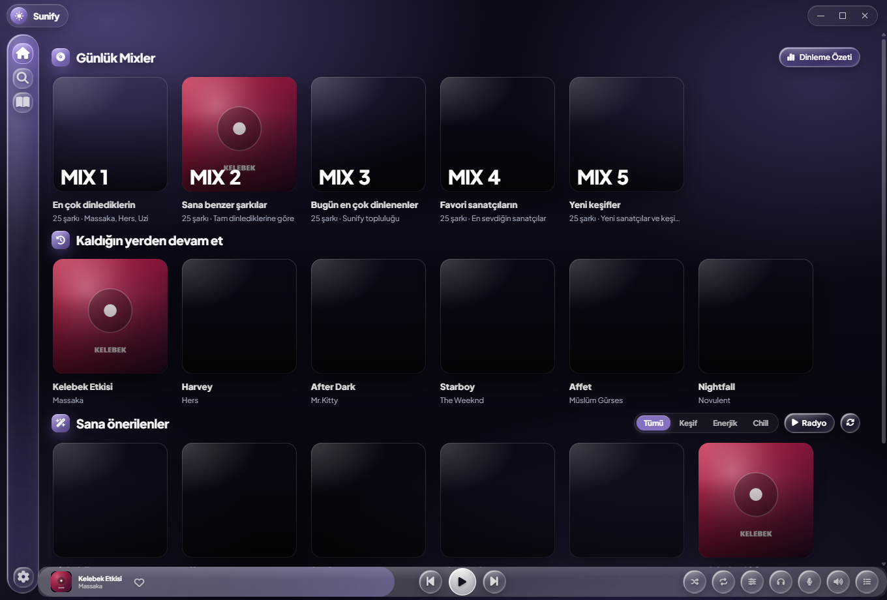
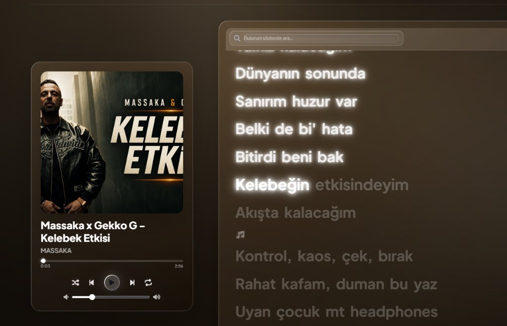
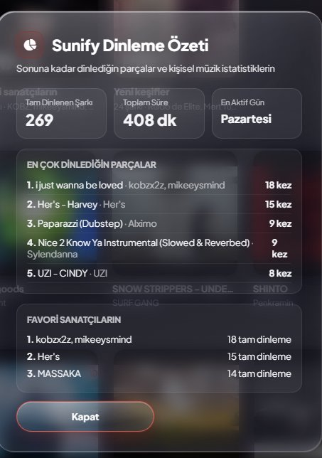
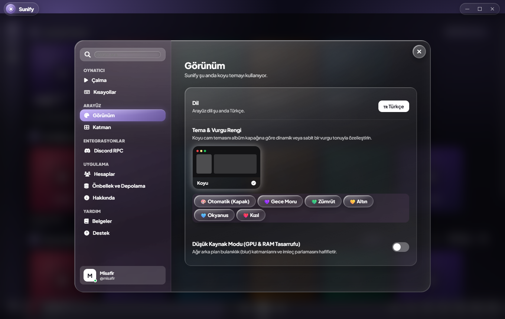
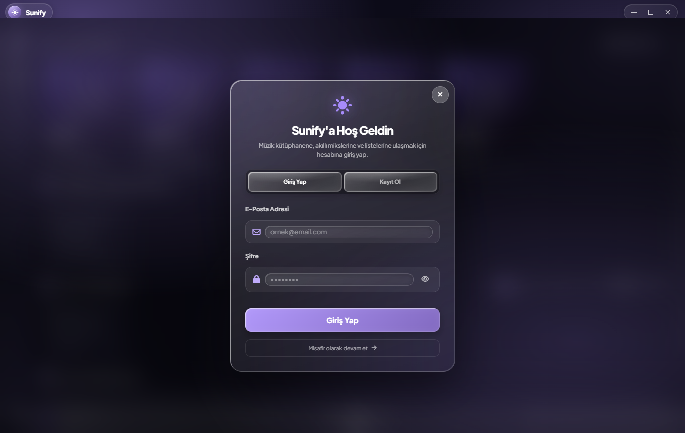

<div align="center">

# ☀️ Sunify

**Modern, hafif ve sıvı cam (*Liquid Glass*) tasarımlı masaüstü müzik çalar**

Hece hece senkronize şarkı sözleri · Akıllı öneri motoru · Discord Rich Presence · Masaüstü Mini Oynatıcı

[](https://www.electronjs.org/)
[](https://nodejs.org/)
[](LICENSE)

</div>

---

## 📸 Uygulamadan Görüntüler

### 🏠 Ana Sayfa & Günlük Mixler
Albüm kapağına göre dinamik değişen sıvı cam arayüzü, kişiselleştirilmiş **Günlük Mixler**, **Kaldığın Yerden Devam Et**, mod sekmeli **Sana Önerilenler** (*Tümü, Keşif, Enerjik, Chill*) ve tek tıkla **Öneri Radyosu**.



---

### 🎤 Hece Hece Senkronize Şarkı Sözleri & Odak Modu
LRCLIB, Kugou, NetEase ve Genius destekli çok kaynaklı söz motoru; kelime/hece bazlı parlama, zaman gecikmesi ayarı, **Odak / Sinema Modu (`C`)** ve sağ tıkla söz satırı kopyalama.



---

### 📊 Kişisel Dinleme Özeti & Ayarlar
Atlanmadan sonuna kadar dinlenen parçaları ölçen kişisel dinleme özeti (*Sunify Wrapped*), tema vurgu renkleri, 5 bantlı ekolayzır, ses dengeleme, masaüstü mini katman ve önbellek yönetimi.

<table>
  <tr>
    <td width="50%">
      
      <p align="center"><sub><b>Sunify Dinleme Özeti</b></sub></p>
    </td>
    <td width="50%">
      
      <p align="center"><sub><b>Görünüm, Vurgu Renkleri & Ayarlar</b></sub></p>
    </td>
  </tr>
</table>

---

### 🔐 Hesap & Bulut Eşitleme
Supabase destekli hesap yönetimi ve yerel misafir modu ile çalma listeleri, beğeniler ve dinleme istatistiklerini cihazlar arasında eşitleme.



---

## ✨ Öne Çıkan Özellikler

- **Sıvı Cam (*Liquid Glass*) Arayüzü:** Çalan albüm kapağına göre otomatik renk uyumu veya **Gece Moru, Zümrüt, Altın, Okyanus, Kızıl** sabit vurgu temaları; **Düşük Kaynak Modu** ile GPU/RAM tasarrufu.
- **Gelişmiş Şarkı Öneri Motoru:**
  - Tam dinleme süresi, tazelik, beğeni ve ilk 18 saniyede erken atlama (*skip*) sinyallerini işleyen çok katmanlı puanlama.
  - **Tümü · Keşif · Enerjik · Chill** modları, ortak kesişim (*co-occurrence*) bonusu ve *"Neden Önerildi?"* rozetleri.
  - **Günlük Mixler:** *En Çok Dinlediklerin*, *Sana Benzer Şarkılar*, *Bugün En Çok Dinlenenler*, *Favori Sanatçıların* ve *Yeni Keşifler*.
- **Çok Kaynaklı Senkronize Şarkı Sözleri:** LRCLIB, Kugou, NetEase, Genius ve Türkçe söz kaynakları arasında otomatik seçim, hece/kelime takibi ve `±0.1s` gecikme ayarı.
- **Zengin Masaüstü Deneyimi:**
  - **Yüzen Mini Oynatıcı Katmanı** (`Alt + Shift + O`): Küçük/Orta/Büyük boyut, opaklık ve ses kontrolü.
  - **Windows Medya Tuşları, Görev Çubuğu Kontrolleri & Sistem Tepsisi (Tray):** Kapatıldığında arka planda çalmaya devam etme.
  - **Özel Cam Sağ Tık Menüsü:** Şimdi çal, sıradaki olarak çal, beğen, listeye ekle, indir, sanatçıya git, bağlantı kopyala.
  - **Çalma Listesinde Sürükle-Bırak Sıralama**, **5 Bantlı Ekolayzır**, **Crossfade (0–8 sn)**, **Oynatma Hızı (0.85x–1.25x)**, **Loudness Normalization** ve **Uyku Zamanlayıcısı**.
- **Discord Rich Presence (RPC):** Albüm kapağı, ilerleme zaman çizelgesi, duraklatma göstergesi ve **"🎵 Sunify'da Dinle"** / **"✨ Sunify'ı İndir"** butonları.
- **Akıllı Depolama & Düşük Kaynak Kullanımı:** Otomatik ses önbelleği temizliği (`512 MB` varsayılan sınır, 2 gün TTL), çevrimdışı yerel indirmeler ve pencere simge durumundayken otomatik bellek boşaltma.

---

## ⌨️ Klavye Kısayolları

| Kısayol | İşlev |
| :--- | :--- |
| `Space` | Çal / Duraklat |
| `Ctrl` + `Right` / `Left` | Sonraki / Önceki parça |
| `Right` / `Left` | İleri / Geri sar (`±5 sn`) |
| `Up` / `Down` | Ses seviyesini artır / azalt |
| `M` | Sesi kapat / aç |
| `/` | Hızlı Arama (Spotlight) |
| `Q` | Çalma Sırası çekmecesini aç / kapat |
| `F` | Tam ekran |
| `C` | Şarkı sözleri ekranında Sinema / Odak Modu |
| `Alt` + `Shift` + `O` | Masaüstü Mini Oynatıcıyı aç / kapat *(Sistem geneli)* |

---

## 🚀 Proje Mimarisi

```text
Sunify/
├── src/
│   ├── main/               # Electron Ana Süreci, Mini Oynatıcı, Sistem Tepsisi & Preload
│   ├── renderer/           # Arayüz (HTML5, Vanilla JS, Glass/Modern CSS)
│   ├── services/
│   │   ├── audio/          # yt-dlp ses akışı, akıllı önbellek, şarkı sözü motoru & metadata temizleyici
│   │   ├── auth/           # Yerel profil, şifreli oturum ve Supabase bulut eşitleme
│   │   ├── rpc/            # Discord Rich Presence servisi
│   │   └── updates/        # Sürüm güncelleme denetleyici
│   ├── utils/              # Yardımcı araçlar
│   ├── config.js           # Yapılandırma ve port ayarları
│   └── server.js           # Yerel Express API ve öneri/önbellek sunucusu
├── docs/screenshots/       # README ekran görüntüleri
├── scripts/                # Windows paketleme ve runtime hazırlık betikleri
└── tests/                  # Birim ve entegrasyon testleri
```

---

## 🛠️ Kurulum & Geliştirme

### Gereksinimler
- **Node.js 20+**
- **Python 3.10+** *(isteğe bağlı, yerel `yt-dlp` geliştirme ortamı için)*

### Başlatma

```bash
# 1. Bağımlılıkları yükleyin
npm install

# 2. (İsteğe bağlı) Python yt-dlp ses motorunu kurun
npm run setup:python

# 3. Uygulamayı başlatın
npm start
```

### Test, Kalite & Kurulum Paketi

```bash
# ESLint kod kontrolü
npm run lint

# Birim testlerini çalıştır
npm test

# Windows NSIS kurulum (.exe) paketi oluştur
npm run build:win
```

---

<div align="center">
  <sub>MIT Lisansı ile geliştirilmiştir · <a href="https://github.com/Kadir-72I/Sunify/releases/latest">Son Sürümü İndir</a></sub>
</div>
